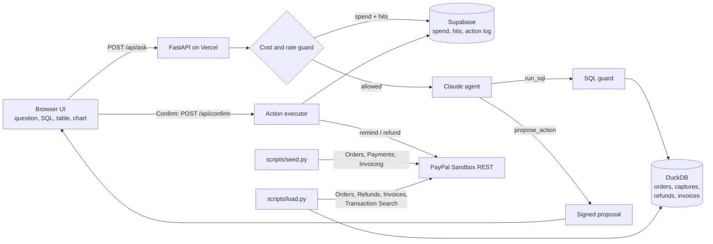

# PayPal Ledger Analyst

**Ask your PayPal ledger questions in plain English — and act on the answer with one click.**

PayPal Ledger Analyst loads a merchant's PayPal orders, captures, refunds and invoices into DuckDB and lets a Claude agent answer questions like *"Which invoices are overdue more than 7 days?"* or *"What's our refund rate by product category?"*. Every answer shows the **generated SQL**, the **result table**, and a **chart** when it helps, so the numbers are always transparent and checkable.

When a question calls for follow-up, the agent can **propose a sandbox action** — sending invoice reminders or issuing a refund. Nothing runs until you click **Confirm**, and every PayPal API call is shown in a result log.

> Everything runs against the **PayPal sandbox** (`api-m.sandbox.paypal.com`) with sample data.

**Live demo:** https://paypal-ledger-analyst.vercel.app

## How PayPal is used

| PayPal API | Used for |
|---|---|
| OAuth 2.0 client credentials | Access token for all calls |
| Orders v2 (`/v2/checkout/orders`) | Seed orders (card-captured and open), load order + capture details |
| Payments v2 (`/v2/payments/captures/{id}/refund`, `/v2/payments/refunds/{id}`) | Seed refunds, load refund details, optional refund action |
| Invoicing v2 (`/v2/invoicing/invoices`, `/send`, `/payments`, `/remind`) | Seed invoices with staggered due dates, load invoices, **send reminders** |
| Transaction Search (`/v1/reporting/transactions`) | Tried first for discovery; if it isn't enabled for the app or hasn't indexed yet, the loader uses the ids recorded by the seed script |

## How AI is used

A Claude model (default `claude-haiku-4-5`, override with `ANTHROPIC_MODEL`) runs a short tool loop (max 4 steps) with two tools:

- **`run_sql`** — runs one read-only DuckDB `SELECT`. Guarded three ways: a statement-type + keyword/function check (`ledger/sqlguard.py`), a `read_only` DuckDB connection with external access disabled, and a 200-row cap. The agent can also name chart axes.
- **`propose_action`** — returns a pending action (invoice reminders or refunds) with the affected rows re-queried by the server. The proposal is HMAC-signed and expires after 15 minutes; `/api/confirm` only executes a valid, signed proposal after the user clicks **Confirm**.

**Cost guard:** token usage is priced per call and stored persistently (Supabase, via secret-checked RPC functions). Once estimated cumulative spend reaches `SPEND_CAP_USD` (default `9.0`), the API stops calling the model and shows a friendly message. A per-IP rate limit (default 8 questions / 10 min, 40 / day) keeps the demo fair for everyone.

## Architecture



## Run it locally

```bash
python -m venv .venv && . .venv/bin/activate
pip install -r requirements-dev.txt
cp .env.example .env   # fill in values, then: set -a; . ./.env; set +a

python scripts/seed.py   # create sandbox orders, captures, refunds, invoices (writes data/seed_manifest.json)
python scripts/load.py   # pull them from PayPal into data/ledger.duckdb
uvicorn api.index:app --reload   # open http://localhost:8000
pytest -q                # SQL guard + cost cap tests
```

| Env var | Required | Purpose |
|---|---|---|
| `PAYPAL_SANDBOX_CLIENT_ID`, `PAYPAL_SANDBOX_SECRET` | yes | PayPal sandbox REST app |
| `ANTHROPIC_API_KEY` | yes | Claude agent |
| `ANTHROPIC_MODEL` | no | default `claude-haiku-4-5` |
| `SUPABASE_URL`, `SUPABASE_ANON_KEY`, `APP_SECRET` | for hosting | persistent spend/rate/action store (schema in `supabase/cost_guard.sql`); `APP_SECRET` also signs proposals. Without them an in-memory store is used |
| `SPEND_CAP_USD`, `RATE_PER_10MIN`, `RATE_PER_DAY` | no | guard settings |

**Deploy:** `vercel deploy --prod` (the FastAPI app in `api/index.py` serves the UI and API; `data/ledger.duckdb` ships with the function). Set the env vars above in the Vercel project.

## Sample questions

- Which invoices are overdue more than 7 days?
- What's our refund rate by product category?
- Total captured vs refunded amount by customer
- How much is outstanding on unpaid invoices, by due week?
- Remind everyone whose invoice is more than 7 days overdue

## License

[MIT](LICENSE)
